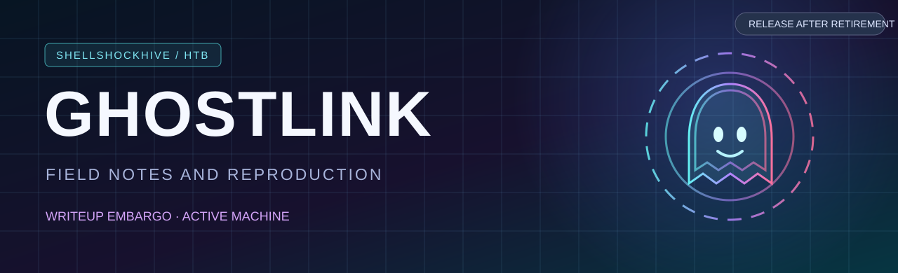

# Ghostlink

*Independent machine research. Technical reproduction will be published after official retirement.*

---

## Publication status

Ghostlink is an **active Hack The Box machine** as of October 24, 2026. Hack The Box [prohibits publishing active-machine solutions, hints, and flags](https://help.hackthebox.com/en/articles/5188925-streaming-writeups-walkthrough-guidelines). This page intentionally contains no solution details.

The analysis is being performed directly against a user-assigned HTB lab instance. No official writeup, walkthrough, community solution, or spoiler is being used.

## What the finished writeup will include

A reproducible investigation, with commands, response excerpts, observed failures, and the reasons each test was selected. Findings will be separated from hypotheses. Successful access and flag recovery will only be claimed if verified against the machine.

The finished edition will include an attack-path diagram, a command-by-command lab procedure, relevant screenshots, concise explanations of each protocol and failure mode, and a section on what could invalidate the result after a service or configuration change.

## Reading key

| Color | Meaning |
| :--- | :--- |
| 🟫 **Brown** | Syntax, shell commands, and options |
| 🟦 **Blue** | Lesson and procedure sections |
| 🟪 **Purple** | Important constraints, prerequisites, and uncertainty |
| 🟩 **Green** | A verified observation or confirmed vulnerability |
| ⬜ **White** | Explanatory text and context |

This follows the color-coding approach already used in [Shellshock9001's HTB writeups](../README.md).

---

ShellShockHive research · publish responsibly · verify everything

